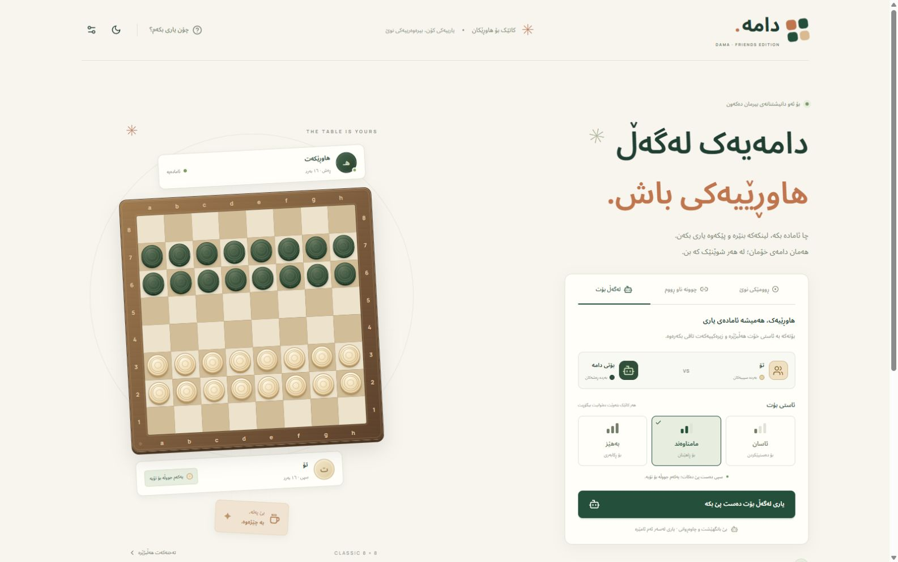

# دامە · DAMA WITH FRIENDS

یاری دامەی کوردی / تورکی بە ڕووکارێکی کوردی، بۆ تۆ و هاوڕێکانت. دوو یاریزان و تا دوو تماشاکەر لە هەر ڕوومێک. مۆبایل و کۆمپیوتەر پشتگیری دەکرێن.

Repository: [ibrahim-ibo-dev/dama](https://github.com/ibrahim-ibo-dev/dama)



## تایبەتمەندییە نوێیەکان

- ڕووکاری ڕۆژ و شەو، سێ شێوەی تەختە، جووڵەی نەرم و ڕێکخستنی دەنگ، پیت و ژمارەی خانەکان.
- دوگمەی **تەنیا تەختە** تەختەکە بە گەورەیی شاشەکە پیشان دەدات؛ چات و پانێڵەکان لادەچن. بە Esc یان دوگمەی × بگەڕێوە. ئەگەر وێبگەڕ fullscreenی خۆی پشتگیری نەکات، دۆخی پڕشاشەی ناو پەڕە هەر کار دەکات.
- **لەگەڵ بۆت** هەڵبژێرە: ئاسان، مامناوەند یان بەهێز. تۆ بە سپی یاری دەکەیت و بۆت بە ڕەش. ئاستەکە لە کاتی یاریداش دەگۆڕدرێت؛ بۆت Redis یان هاوڕێیەکی ئۆنڵاین پێویست نییە.
- گەڕاندنەوەی جووڵە لە تاقیکردنەوە و یاری لەگەڵ بۆت. لەگەڵ بۆت، نۆرەی تۆ و وەڵامی بۆتەکە پێکەوە دەگەڕێنەوە.
- گفتوگۆ و وەڵامی خێرا بۆ یاریزان و تماشاکەران، هەڵگرتنی دوا ٤٠ پەیام و ئەنجامی دوا ٢٠ یاریی هەمان ڕووم. خاڵەکان بە ناوی یاریزان هەڵدەگیرێن، تەنانەت دوای گۆڕینی ڕەنگەکان.

### یارمەتیدەری تایبەتی ناوخۆ

لە ناو یارییەکدا **Alt + Shift + B** دابگرە، یان لە مۆبایل نیشانەی **✳**ی کۆتایی پەڕە بۆ ١.٥ چرکە ڕابگرە. یارمەتیدەرەکە چالاک دەبێت و دواتر نیشانەیەکی بچووک لە کۆنترۆڵەکانی تەختەی هەمان وێبگەڕدا دەردەکەوێت. دوگمەی گشتیی «ئاماژەیەک» لابراوە.

یارمەتیدەر جووڵەیەکی بەهێز پێشنیار دەکات و دەتوانیت بە «ئەم جووڵەیە بکە» جێبەجێی بکەیت. پێشنیار و هەڵبژاردنی یارمەتیدەر بۆ هاوڕێکان نانێردرێن؛ تەنیا جووڵەی ڕێگەپێدراوی تەختە هاوبەش دەکرێت. چالاکبوونی یارمەتیدەر هەڵبژاردنێکی ناوخۆیی وێبگەڕە، نەک ناساندنەوەی هەژمار.

بۆت و یارمەتیدەر بە گەڕانی سنوورداری چەند نۆرەی داهاتوو کار دەکەن؛ پێشنیاریان بەهێزترین جووڵەی دۆزراوەی ئەو گەڕانەیە، بەڵێنی باشترین جووڵەی تەواو و بێهەڵە نییە. بیرکردنەوە لە Web Worker جێبەجێ دەکرێت تا ڕووکارەکە ئاسان بەکاربهێنرێت.

## بەکارهێنان

١. ناوەکەت بنووسە و «ڕوومێک دروست بکە» دابگرە.

٢. «کۆپیکردنی لینک» دابگرە و لینکەکە بۆ هاوڕێکەت بنێرە.

٣. هاوڕێکەت ناوی خۆی بنووسێت و وەک یاریزان بچێتە ژوورەوە. سپی یەکەم جووڵە دەکات.

٤. دوو کەسی تر دەتوانن هەمان لینک بکەنەوە و «تماشاکەر» هەڵبژێرن. بۆ یارییەکی دیکە، ڕوومێکی دیکە دروست بکەن.

ڕوومەکان لیستی گشتییان نییە. هەر کەسێک لینک/کۆد و وشەی نهێنییە هاوبەشەکەی هەبێت، دەتوانێت پەیوەست بێت. بۆ سنووردارکردنی ماڵپەڕەکە بە هاوڕێکانت، `SITE_PASSWORD` دابنێ. ناوی بەکارهێنەر و هەژمار پێویست نییە.

## هۆستکردن لە Vercel

**گرنگ:** بۆ هەماهەنگکردنی دوو ئامێر، Redis پێویستە. هەڵگرتنی دۆخی یاری لە RAMی Vercel دروست کار ناکات؛ ئەم پڕۆژەیە بە Redis چارەسەری دەکات.

١. ئەم پڕۆژەیە لە repositoryی تایبەتی [ibrahim-ibo-dev/dama](https://github.com/ibrahim-ibo-dev/dama) هەیە. لە Vercel بە هەمان هەژماری GitHub بچۆ ژوورەوە و دەستگەیشتن بە ئەم repositoryیە بدە.

٢. لە [Vercel](https://vercel.com/new)، **Add New → Project**، پڕۆژەکەت Import بکە. Framework بە **Next.js** دەناسرێتەوە؛ Root Directory هەمان فولدەری `package.json` بێت. Deploy بکە.

٣. لە داشبۆردی پڕۆژەکە **Storage / Marketplace → Upstash Redis** هەڵبژێرە، database دروست بکە یان یەکێکی هەبوو پەیوەست بکە. بەستنی database بە پڕۆژەکە دڵنیابکەوە. ئەم دوو گۆڕاوە دەبێت لە **Settings → Environment Variables** هەبن:

```text
UPSTASH_REDIS_REST_URL
UPSTASH_REDIS_REST_TOKEN
```

ئەگەر integrationەکە prefixی `KV` بەکاربهێنێت، `KV_REST_API_URL` و `KV_REST_API_TOKEN`یش پشتگیری دەکرێن. تەنیا `REDIS_URL` بۆ ئەم پڕۆژەیە بەس نییە؛ REST URL و REST token بەکاربهێنە.

٤. بۆ تایبەتیی زیاتر، `SITE_PASSWORD` لە Environment Variables دابنێ؛ وشەیەکی درێژ هەڵبژێرە و بە هاوڕێکانت بڵێ. هیچکام لە نهێنییەکان بە `NEXT_PUBLIC_` دەست پێ نەکەن.

٥. لە **Deployments → Redeploy** پڕۆژەکە نوێ بکەرەوە تا گۆڕاوەکان بخوێندرێنەوە. لینکی `*.vercel.app` بکەرەوە. ئەگەر دەستگەیشتنی هاوڕێکان بە Vercel login داوا کرا، لە **Settings → Deployment Protection** ڕێکخستنەکانی Production بپشکنە؛ وشەی نهێنیی خودی دامە جیاوازە.

سەرچاوەی فەرمی: [Redis on Vercel](https://vercel.com/docs/redis)، [Upstash Vercel integration](https://upstash.com/docs/redis/howto/vercelintegration).

## تاقیکردنەوە لە کۆمپیوتەر

Node.js 20.9+ پێویستە (Node.js 22 پێشنیار دەکرێت).

```powershell
npm ci
npm run dev
```

[http://localhost:3000](http://localhost:3000) بکەرەوە. بۆ تاقیکردنەوەی دوو یاریزان، دوو tabی جیاواز بەکاربهێنە. ئەگەر tabەکەت Duplicate کرد و هەمان یاریزانی پیشان دا، پەنجەرەی Incognito بەکاربهێنە.

بەبێ Redis، تەنیا لە developmentدا هەڵگرتنی کاتی لە RAM کار دەکات. بە دووبارە دەستپێکردنی سێرڤەر ڕوومەکان دەسڕدرێنەوە. بۆ تاقیکردنەوەی Redis، `.env.example` کۆپی بکە بۆ `.env.local` و گۆڕاوەکان پڕ بکەرەوە. لە Productionدا fallbackی RAM نییە؛ ئەگەر Redis پەیوەست نەبێت، ماڵپەڕەکە بە ڕوونی پێت دەڵێت.

```powershell
npm test
npm run typecheck
npm run build
```

## یاساکانی ئەم وەشانە

- ٨×٨، ١٦ بەرد بۆ هەر یاریزان؛ ڕیزی یەکەم بەتاڵە. سپی دەست پێ دەکات.
- بەردی ئاسایی: پێشەوە یان لایەکان، یەک خانە. هیچ جووڵە یان خواردنی قطری/بۆدواوە نییە.
- خواردن ناچارییە و دەبێت درێژترین زنجیرەی خواردن هەڵبژێردرێت. بەردی خوراو یەکسەر لادەبرێت.
- دامە بە چوار ئاراستەی ڕاست چەند خانەیەک دەجووڵێت/دەخوات. لە نێوان دوو خواردندا گەڕانەوەی ١٨٠ پلە ڕێگەپێنەدراوە.
- بەرد تەنیا لە **کۆتایی تەواوی نۆرەکە** لەسەر ڕیزی کۆتایی دەبێتە دامە.
- بێ بەردبوون یان نەبوونی جووڵە دۆڕانە. سێ جار هەمان دۆخ یەکسانییە. یەک بەرد بەرامبەر بە یەک بەرد یەکسانییە، مەگەر دامە بەرامبەر بە ئاسایی، کە دامە دەباتەوە.
- داوای یەکسانی، وازهێنان و یارییەکی تر بە ڕەزامەندی هەردوو یاریزان هەیە. لە یارییەکی نوێدا ڕەنگەکان دەگۆڕدرێن.

## Technical notes

Next.js App Router, React, TypeScript and Upstash Redis over HTTPS. No continuously running socket server is required. Clients refresh the room approximately every two seconds while visible and send a heartbeat every twenty seconds; hidden tabs pause polling. This is near-live synchronization, not instant WebSocket delivery. For 2–4 friends this keeps setup small; check your Vercel/Upstash quotas and pricing before choosing a plan.

The server validates every move and authorizes players with a random per-tab capability held in `sessionStorage`; only its SHA-256 hash is stored. A refresh in the same tab restores the seat. A new browser, cleared storage or closed tab does not recover that identity. Do not share the player token. Names are plain text and room links contain no player credentials. Room codes carry 50 bits of randomness. A shared `SITE_PASSWORD`, when set, gates room creation and joining, not existing authorized sessions.

Redis compare-and-swap scripts serialize concurrent joins/moves/rematches across Vercel instances. Duplicate or stale moves cannot be applied twice. Presence is approximate: a disconnected player is marked offline after about 50 seconds; disconnection alone does not forfeit. Leaving through the game controls forfeits an active game. Player seats are retained for the room lifetime so refresh/reconnect preserves identity; spectators can explicitly leave and free their seats. A room expires after 24 hours without a write/heartbeat. Rooms have no public index and are not searchable.

All fonts are served locally. Game pieces and board are CSS, with no external images or trackers. The browser also includes an explicitly labeled hot-seat practice game that works without Redis.
